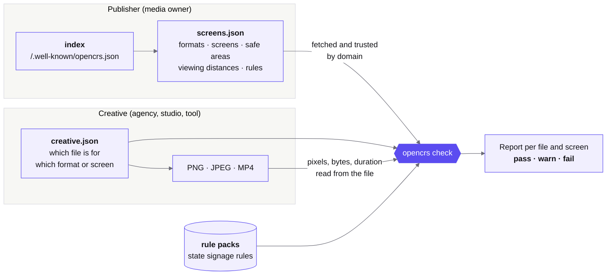
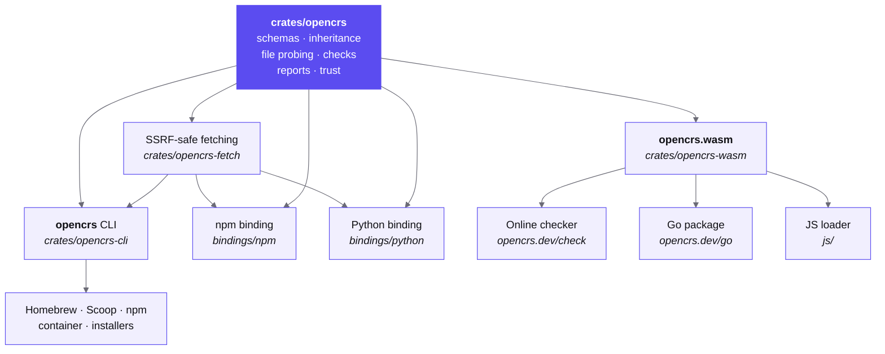

<p align="center">
  <a href="https://opencrs.dev">
    <picture>
      <source media="(prefers-color-scheme: dark)" srcset=".github/assets/opencrs-mark-on-dark.svg">
      
    </picture>
  </a>
</p>

<h1 align="center">OpenCRS</h1>

<p align="center">
  <b>Every screen, described once. Every creative, right first time.</b><br>
  The Open Creative Requirements Specification: one machine-readable file, on a publisher's own domain,<br>
  that says what creative needs in order to work on each of its digital screens.
</p>

<p align="center">
  <a href="https://github.com/OpenCRS-Org/opencrs/releases/latest"></a>
  <a href="https://opencrs.dev/spec/0.1/"></a>
  <a href="conformance/"></a>
  <a href="https://github.com/OpenCRS-Org/opencrs/actions/workflows/ci.yml"></a>
  <br>
  <a href="https://www.npmjs.com/package/@opencrs/cli"></a>
  <a href="https://github.com/OpenCRS-Org/homebrew-tap"></a>
  <a href="https://github.com/OpenCRS-Org/opencrs/pkgs/container/opencrs"></a>
  <a href="https://pkg.go.dev/opencrs.dev/go"></a>
  <br>
  
  
  <a href="LICENSE"></a>
  <a href="LICENSE-SPEC"></a>
</p>

<p align="center">
  <a href="https://opencrs.dev/spec/0.1/"><b>Read the spec</b></a> ·
  <a href="https://opencrs.dev/check/"><b>Try the online checker</b></a> ·
  <a href="https://opencrs.dev/examples/"><b>Example files</b></a> ·
  <a href="https://github.com/OpenCRS-Org/opencrs/issues"><b>Comment on the draft</b></a>
</p>

---

A media owner's spec sheet is a PDF. Every agency, studio and tool reads it by eye, and creative still comes back wrong: the logo sits under the screen's own branding, the legal line is too small to read from the street, the video is two seconds too long. OpenCRS™ turns the spec sheet into data that a publisher hosts once and every tool can check against.



## See it

```console
$ opencrs check --spec retail.screens.json creative.json
lunch-portrait.png → harbourline.example/retail/portrait-totem-75: FAIL
  warning     CRS-LEGIBILITY         Legal text is 18 px; 16 px minimum at 2 m, ratio 150. Passes with little margin  [HC-L1-001]
  warning     CRS-LEGIBILITY         Headline text is 92 px; 77 px minimum at 10 m, ratio 150. Passes with little margin  [HC-L1-002]
  error       CRS-LEGIBILITY         Legal text is 18 px; 23 px minimum at 3 m, ratio 150  [HC-L1-002]

lunch-portrait-logo-right.png → harbourline.example/retail/screen/HC-L1-001: FAIL
  error       CRS-SAFE-AREA          Logo extends into the safe-area margin (top 120 px)
  error       CRS-BLOCKED-REGION     Logo overlaps the network-logo area
```

The same file passes on one totem and fails on its twin, because the second is seen from further away. That is the point of describing screens the way people see them. Try these files in the [online checker](https://opencrs.dev/check/?example=harbourline); nothing is uploaded.

## Install

| Platform | Command |
| --- | --- |
| **macOS, Linux** | `brew install opencrs-org/tap/opencrs` &nbsp;(with the man page and shell completions) |
| **Windows** | `scoop bucket add opencrs https://github.com/OpenCRS-Org/scoop-bucket` then `scoop install opencrs` |
| **Node.js** | `npx @opencrs/cli --help` |
| **Container** | `docker run --rm -v "$PWD:/work" ghcr.io/opencrs-org/opencrs --help` |
| **Script** | `curl --proto '=https' --tlsv1.2 -LsSf https://github.com/OpenCRS-Org/opencrs/releases/latest/download/opencrs-cli-installer.sh \| sh` |
| **Go** | `go get opencrs.dev/go` |
| **Source** | `cargo build --release -p opencrs-cli` &nbsp;(a single binary, no runtime) |

Every [release](https://github.com/OpenCRS-Org/opencrs/releases) has archives for macOS, Linux (glibc and static musl) and Windows, on Intel and Arm, with checksums and build attestations: `gh attestation verify $(which opencrs) --repo OpenCRS-Org/opencrs`.

## Commands

| Command | What it does |
| --- | --- |
| `opencrs check --spec SCREENS CREATIVE` | Checks each file a `creative.json` lists against every screen it targets. Repeat `--spec` for several publishers; `--json` prints reports in the spec's format. |
| `opencrs schema FILE…` | Checks documents against the JSON Schemas, plus screens that name a missing format (`CRS-REFERENCE`) and rules inheritance has made impossible (`CRS-RULE-CONFLICT`). |
| `opencrs resolve SCREENS REF` | Shows what one format or screen requires after inheritance, with minimum text sizes in mm and px and the word limit. With `--strictest`, shows one set of requirements for everything the reference covers, so a single file passes on every screen. |
| `opencrs fetch DOMAIN` | Reads a publisher's index, fetches its documents, follows delegates, and says which to trust and why. `--output DIR` saves the trusted ones. |
| `opencrs publisher DOMAIN` | The publisher check: fetches a publisher's specs as `fetch` does, then reports each document's own problems and how each file is served (Cache-Control, ETag, compression, content type). |
| `opencrs probe FILE…` | Shows what the validator reads from each file: type, pixel size, bytes, SHA-256 and, for video, duration. `--json` prints an array. |
| `opencrs legibility --near M --far M` | Works out the smallest legible text for a viewing distance. Add `--screen-width-mm` and `--screen-width-px` for pixels, `--dwell` for a word limit. |
| `opencrs dwell --speed KMH --near M --far M` | Works out what a driver can read of a sign at a speed. `--pack REF` adds a rule pack's limits at that speed. |
| `opencrs rule-packs [REF]` | Lists the built-in rule packs, or shows one pack's limits. `--json` for the list or the pack document. |
| `opencrs conformance` | Runs the conformance suite against this validator, or against any other with `--cmd`. |
| `opencrs completion SHELL` | Prints completions for bash, zsh, fish or PowerShell. |
| `opencrs version` | Shows the tool, spec and rule pack versions. |

`opencrs COMMAND --help` has examples for each, and `man opencrs` has the lot. Exit status is 0 when everything passes, 1 when something fails, and 2 for a usage or read error.

<details>
<summary><b>What gets checked</b></summary>

<br>

The validator reads each file's type, pixel size, byte size and SHA-256 (and duration, for MP4) from the file itself. Values the manifest declares are used only when the file isn't there (`--no-files`).

| Level | A publisher provides | The validator checks | Cases |
| --- | --- | --- | --- |
| **Core** | Formats with `pixels` and `media`, screens, an index | `CRS-PIXELS` `CRS-MEDIA-TYPE` `CRS-FILE-SIZE` `CRS-DURATION` `CRS-SPEC-STALE` | 16 |
| **Layout** | Core, plus safe areas, blocked regions and segments | Core, plus `CRS-SAFE-AREA` `CRS-BLOCKED-REGION` | 4 |
| **Full** | Layout, plus physical size, viewing context and rules | Everything: `CRS-LEGIBILITY` `CRS-MAX-WORDS` `CRS-REQUIRED-ELEMENT` `CRS-CATEGORY` `CRS-MOTION` and the rule packs | 27 |

Not yet implemented: segment checks for composite surfaces, and audio, codec and colour-space checks.

</details>

<details>
<summary><b>Regulatory rule packs</b></summary>

<br>

Rule packs are built into the validator (and the browser build) from [`rulepacks/`](rulepacks/). A screen that lists one, such as `"rule_packs": ["au-nsw-transport-corridor@2017-11"]`, is checked against it with no extra flags.

- **Creative rules** give `CRS-MOTION-PROHIBITED`, `CRS-TRAFFIC-DEVICE`, `CRS-GLANCE-TEXT` and `CRS-SEQUENCING`.
- **`CRS-TRAFFIC-DEVICE` needs a person:** whether a file looks like a traffic sign is `not_checked` until the manifest attests that someone reviewed that exact file (by SHA-256). Then it's `info`, naming the reviewer, and the file can pass.
- **Playback rules** (dwell, transition, failure state, luminance, school zones) appear as `CRS-PLAYBACK` info lines for the screen's speed and lighting zone, and never fail creative.
- A pack the validator doesn't know is reported as `CRS-RULE-PACK`, not checked.

| Pack | Status |
| --- | --- |
| `au-nsw-transport-corridor@2017-11` | draft |
| `au-qld-tmr-roadside-advertising@2022-12` | draft |
| `au-sa-dit-advertising-signs@2014-08` | draft |
| `au-vic-dtp-illuminated-signage@2023-10` | draft |
| `au-wa-mrwa-digital-signs@2025-05` | draft |
| `au-tas-spp-signs-code@2024-06` | unverified, until amendments after its June 2024 edition are checked |

Each is checked against the state's own guidelines or planning rules, with page or section citations, and its `notes` say what it leaves out. The NT and the ACT have no territory-wide rule for digital signs, so they have no pack.

</details>

<details>
<summary><b>Fetching and trust</b></summary>

<br>

```sh
opencrs fetch harbourline.example                                     # the index, every document, delegates
opencrs fetch https://specs.cms-a.example/harbourline/airports.screens.json   # does its publisher vouch for this URL?
opencrs fetch --token harbourline.example=TOKEN --output specs harbourline.example   # partner documents too, saved
```

Each document is marked `trusted`, `expired`, `rejected`, `skipped` (a partner document without credentials) or `failed`, with the reason. `--output` saves trusted documents byte for byte, ready for `opencrs check --spec`; with partner documents it also writes a `merged.screens.json` and lists any conflicts.

`fetch` refuses loopback, private, link-local, CGNAT, multicast, documentation and other internal addresses, checked after DNS resolution and again on every redirect. `--allow-local-http` is the opt-in for testing an index on `localhost` before you deploy it. `fetch` connects directly and ignores `HTTP(S)_PROXY`. Each document is at most 50 MiB, an index may list at most 1,000 documents and 1,000 delegates, and one run reads at most 512 MiB.

</details>

## One validator, everywhere

The checks are written once, in Rust, and every other way of running them uses that same code.



**From Go**, the validator's WebAssembly build is embedded and run with [wazero](https://wazero.io), so there's no cgo:

```go
import opencrs "opencrs.dev/go"

root, err := os.OpenRoot("campaign")
if err != nil { /* … */ }
res, err := opencrs.CheckDir(root.FS(), []string{"retail.screens.json"}, "creative.json", time.Now())
if err != nil { /* … */ }
for _, r := range res.Reports {
    fmt.Println(r.File, r.Target, r.Result) // pass, warn, fail or incomplete
}
```

**In the browser**, the [online checker](https://opencrs.dev/check/) runs the same module, so creative files never leave the machine. The npm (`@opencrs/opencrs`) and Python (`opencrs`) packages are native builds of the same core, published with each release.

Every call, in each place you can run it:

| What it does | CLI | Go | JavaScript (`js/opencrs.js`) | npm | Python |
| --- | --- | --- | --- | --- | --- |
| Check a document against the schemas | `schema` | `Lint` | `lint` | `lint` | `lint` |
| Read a file's type, pixels, size and duration | `probe` (also inside `check`) | `Probe` | `probe` | `probe`, `probeBytes` | `probe`, `probe_bytes` |
| Check creative against the screens it targets | `check` | `Check`, `CheckDir` | `check` | `check`, `checkDir` | `check`, `check_dir` |
| Show a format's or a screen's requirements | `resolve` | `Resolve` | `resolve` | `resolve` | `resolve` |
| One set of requirements for every screen a reference covers | `resolve --strictest` | `ResolveStrictest` | `resolveStrictest` | `resolveStrictest` | `resolve_strictest` |
| Check a publisher's index and documents, from pages you fetched | | `Publisher` | `publisher` | `publisher` | `publisher` |
| Fetch a publisher's documents, say which to trust, and run the publisher check | `fetch` (trust), `publisher` (the whole check) | `FetchPublisher`, `FetchPage`, `SafeClient` | | `fetchPublisher`, `discover` | `fetch_publisher`, `discover` |
| Minimum text size for a viewing distance | `legibility` | `Legibility` | `legibility` | `legibility` | `legibility` |
| How long a viewer sees a screen | `dwell` | `Dwell` | `dwell` | `dwell` | `dwell` |
| List the built-in rule packs and their limits | `rule-packs` | `RulePacks` | `rulePacks` | `rulePacks` | `rule_packs` |
| Tool, spec and rule pack versions | `version` | `Version` | `version` | `version` | `version` |
| Run the conformance suite | `conformance` | | | | |

The blanks are deliberate, and each is listed with its reason in [`parity/operations.json`](parity/operations.json):

- **Fetching has no JavaScript column.** A browser can't read other sites' files (CORS). Fetch them yourself and pass them to `publisher`, which says which URLs it still needs.
- **The CLI has no pages-in check.** `opencrs publisher` fetches the pages itself.
- **The conformance suite runs only in the CLI.** Every other caller is tested against its cases by its own test suite.

That file is the single list of operations, and each caller's tests check their exports against it: adding an operation to it fails Go, JavaScript, npm, Python and CLI tests until each one has the call, or the file says why it can't.

The npm and Python fetchers are the CLI's: one SSRF-safe client (`crates/opencrs-fetch`) that connects only to public addresses, checks them after DNS and on every redirect, uses HTTPS only, ignores proxy settings and caps sizes. `fetchPublisher` and `discover` return Promises and run off the event loop; Python releases the GIL while it waits.

Every Go call also has a `…Context` form that stops when its context is cancelled. `Publisher` returns the URLs it still needs as `Wanted`; they come from the publisher, so fetch them with `SafeClient`, or let `FetchPublisher` run the whole loop.

## What's here

| Path | What's in it |
| --- | --- |
| [`OpenCRS 0.1 Specification.md`](OpenCRS%200.1%20Specification.md) | The specification |
| [`schema/0.1/`](schema/0.1/) | JSON Schemas (Draft 2020-12) for `index`, `screens`, `creative`, `report` and `rule-pack`, served at their `$id` on opencrs.dev |
| [`examples/`](examples/) | The spec's complete Harbourline example, verbatim, with the reports the validator writes, and starter files |
| [`conformance/`](conformance/) | 48 cases (and 9 optional ones for strictest requirements) any validator can run to show it meets Core, Layout or Full ([how to write an adapter](conformance/README.md)) |
| [`rulepacks/`](rulepacks/) | Regulatory rule packs, embedded in the validator |
| [`crates/`](crates/) | The Rust library, the CLI, the WebAssembly module, and the fetching the CLI and native bindings share |
| [`parity/`](parity/) | The list of operations every caller must have, which each caller's tests check |
| [`bindings/`](bindings/) | npm and Python packages over the Rust library |
| [`opencrs.go`](opencrs.go) | The Go package |

## Development

```sh
cargo test --workspace       # the Rust library and CLI
go test -race .              # the Go package
cargo xtask generate         # after changing the command line: man page and completions
```

The tests use the spec's own numbers as acceptance criteria: the worked legibility example (46 px and 16 px), text just below a minimum failing rather than rounding up to pass, restrictions a lower level can't loosen, the 8-word limit from a 4-second dwell, larger text on the further totem, and every JSON example in the spec passing its schema.

<details>
<summary><b>Building the WebAssembly module</b></summary>

<br>

```sh
scripts/build-wasm.sh /tmp/wasm      # needs binaryen's wasm-opt; writes opencrs.wasm and opencrs.js
node js/smoke.mjs /tmp/wasm          # the module must behave like the CLI
```

The committed `opencrs.wasm` is what the Go package embeds. rustc's output differs between hosts, so it's built in a pinned linux/amd64 container (Rust 1.95.0, binaryen 133) with `scripts/build-wasm-docker.sh OUT_DIR`, and CI rebuilds it there and compares byte for byte. Build on your own machine to test; commit the container's build.

</details>

<details>
<summary><b>Checking a creative package from someone else</b></summary>

<br>

Every host (the CLI, the npm and Python bindings, and the Go package's `CheckDir`) reads only the files the manifest names, refuses names with `..` or an absolute path, follows symlinks only while they stay inside the package directory, and probes only regular files. In Go, pass `root.FS()` from `os.OpenRoot(dir)` rather than `os.DirFS(dir)`, so the opens themselves are confined too.

Two limits remain. A hard link inside the package can't be told from an ordinary file, so unpack untrusted archives without hard links (most extractors have an option, and Linux's `protected_hardlinks` blocks links to other users' files). And a concurrent writer to the directory could swap in a symlink between the check and the open, so check a copy no one else can write to.

</details>

The validator was first written in Go. The [differential tests](crates/opencrs-cli/tests/differential/README.md) compare this CLI with that version, output for output.

## Contributing

OpenCRS is a draft, and it gets better with real spec sheets and real creative. [Open an issue](https://github.com/OpenCRS-Org/opencrs/issues) with what doesn't fit, or see [CONTRIBUTING.md](CONTRIBUTING.md) for proposals and pull requests. What comes next is in [ROADMAP.md](ROADMAP.md). Commits are signed off under the [Developer Certificate of Origin](DCO). To report a security problem, see [SECURITY.md](SECURITY.md).

## Licence

The specification is [CC BY 4.0](LICENSE-SPEC). Everything else, including the JSON Schemas, examples and code, is [Apache 2.0](LICENSE). Anyone can implement OpenCRS, including competitors, as the spec's governance section intends.

The licences don't cover the name. OpenCRS™ is a trademark: anyone may say they support OpenCRS, but a modified version can't use the name. See the [trademark policy](https://opencrs.dev/trademark/).
